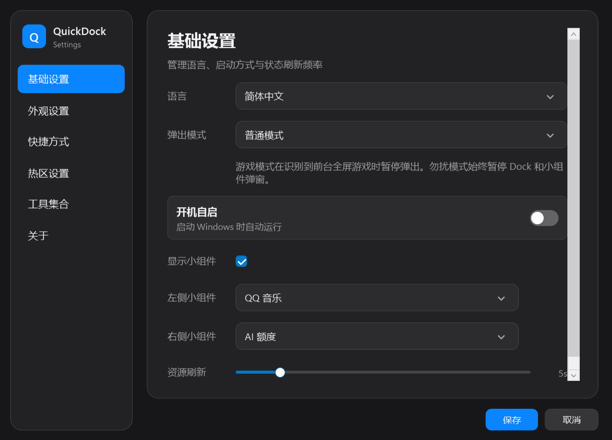

# QuickDock

QuickDock 是一款轻量的 Windows Dock。把鼠标移到屏幕底部即可打开常用程序和网页，也可以在 Dock 上查看天气、设备信息、QQ 音乐或 AI 额度。

<p align="center">
  
</p>

*界面使用示例曲目和额度数据。*

## 下载与安装

1. 从 [GitHub Releases](https://github.com/QingdaoDitie/QuickDock/releases/latest) 下载 Windows x64 ZIP。
2. 使用 Windows 10 1809 或更高版本，或 Windows 11，并安装 [.NET 8 Desktop Runtime（x64）](https://dotnet.microsoft.com/zh-cn/download/dotnet/8.0)。
3. 解压整个 ZIP，运行目录里的 **QuickDock.exe**。首次启动会打开「基础设置」。日常可以从系统托盘菜单进入设置或退出。

升级时先退出 QuickDock，再将新版 ZIP 解压覆盖旧目录。快捷方式和 Dock 设置保存在程序目录的 `config.json`，天气设置保存在 `widget-settings/weather.json`。发布包不会覆盖这些用户文件。

## Dock 与小组件

默认快捷方式包括 CMD、PowerShell（管理员）和 ChatGPT 网页。在「设置 → 快捷方式」可以添加程序、文件夹、网页和命令，也可以把桌面的 `.lnk` 拖到 Dock。工具集支持从指定目录扫描程序，并将工具组织在可展开的面板里。

在「设置 → 基础」为左、右槽位各选一个小组件。选到另一侧正在使用的组件时，两侧会自动交换。

| 小组件 | 功能 |
| --- | --- |
| 天气 | 查看当前天气、短临降水趋势和气象预警。在槽位旁的「设置」中选城市，并调整刷新频率和预警动画。 |
| 设备信息 | 查看 CPU、内存及 GPU 利用率。 |
| QQ 音乐 | 上一首、播放／暂停、下一首。当前歌名显示在按钮右边，悬停可查看完整歌名和歌手。 |
| AI 额度 | 两个圆环显示短时和周额度的剩余百分比。悬停可看各来源的重置时间，点击可刷新。仅展示读取成功的来源。 |

<p align="center">
  
</p>

「普通模式」按热区触发。游戏模式会在检测到前台全屏游戏时暂停弹出，勿扰模式会暂停 Dock 和小组件弹窗。

## 接入 QQ 音乐与 AI 额度

- **QQ 音乐**。在 Windows 版 QQ 音乐中打开「显示系统媒体传输控制（SMTC）」，播放任意一首歌即可连接。QuickDock 使用 Windows 媒体会话读取当前曲目信息。[QQMusicMonitor](https://github.com/GotKiCry/QQMusicMonitor/blob/main/Project.md) · [Windows 媒体会话文档](https://learn.microsoft.com/en-us/uwp/api/windows.media.control.globalsystemmediatransportcontrolssession)
- **Codex**。安装 Codex CLI 并用 ChatGPT 账号登录。QuickDock 会通过本地 Codex App Server 查询额度。自定义安装位置可通过环境变量 `QUICKDOCK_CODEX_PATH` 指向 `codex.exe`。[Codex App Server 文档](https://learn.chatgpt.com/docs/app-server)
- **Claude Code**。使用 Claude Code 的状态栏命令传递订阅额度。收到模型响应后，符合条件的 Claude Code 会向状态栏提供额度快照。QuickDock 随后读取快照。[Claude Code 状态栏文档](https://code.claude.com/docs/en/statusline)

<details>
<summary>配置 Claude Code 状态栏</summary>

在 `%USERPROFILE%\.claude\settings.json` 中加入以下设置，将路径改为本机 QuickDock 安装目录。已有自定义状态栏时，可将相同的状态栏输入同时交给原命令和随包脚本。

```json
{
  "statusLine": {
    "type": "command",
    "command": "powershell.exe -NoProfile -ExecutionPolicy Bypass -File \"C:/Apps/QuickDock/Widgets/ClaudeQuotaStatusLine.ps1\""
  }
}
```

脚本只会把额度百分比和重置时间保存至 `%LOCALAPPDATA%\QuickDock\claude-quota.json`。重置时间过去后，QuickDock 会等待 Claude Code 的下一次快照。

</details>

## 从源码构建

在 Windows 上安装 .NET 8 SDK，并在仓库根目录执行：

```powershell
dotnet build QuickDock.sln -c Release
```

编译输出位于 `QuickDock/bin/Release/net8.0-windows10.0.17763.0/`。公开源码含 Dock、组件接口和三个内置模块。天气作为独立 DLL 分发，发布包内已带 `Widgets/QuickDock.Weather.dll`。源码构建需要天气功能时，将该 DLL 放入输出目录的 `Widgets` 文件夹后重启程序。

## 许可证

公开源码采用 [MIT License](LICENSE)。天气模块以二进制形式随发布包分发。
